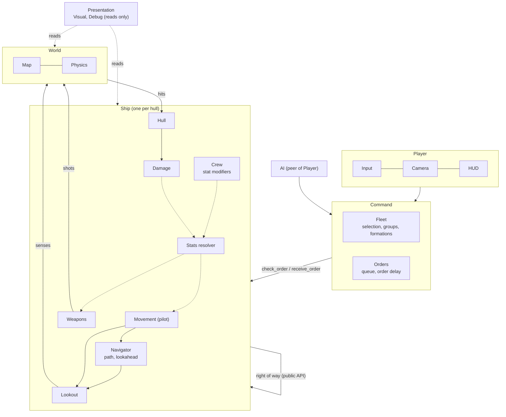

# ARCHITECTURE.md

## Folders

- `.godot` — engine cache (not source)
- `assets` — art and audio
- `design_docs` — gameplay intent (developer-owned)
- `game` — game code and scenes, one folder per architecture layer:
  - `game/player/` — Player layer: input, camera, HUD.
  - `game/command/` — Command layer: `command_controller.gd` (the layer's API), `fleet/` (selection, groups, group slots), `orders/` (order delay and its tuning).
  - `game/ship/` — Ship layer: `ship_base.gd`/`.tscn` (the ship's API), `orders/` (order data), `modules/` (movement, navigator, lookout), `classes/<class>/` (one folder per ship class: scene and profiles).
  - `game/world/` — World layer: `obstacles/`.
  - `game/presentation/` — Presentation layer (reads only): `debug/` (`DebugTools`: overlays, markers; F4 toggle), `sandbox/` (debug main scene).
- `tests` — headless tests (`unit/`, `scenarios/`)

## Units and scale

- 1 world unit (u) ≈ the scale where a frigate hull is 20 u long.
- Tactical movement happens on the XZ plane at y = 0. Heading is rotation around Y; heading 0 faces −Z (Godot forward).
- Time in seconds; authored angles in degrees, runtime angles in radians.
- Plane coordinates (`Vector2`) in module APIs map x → world X, y → world Z. A circle on the plane is `Vector3(x, y, radius)`.
- Physics layers: 1 "ships", 2 "obstacles". Ships collide with both.

## Module map

| Module | Files | Responsibility |
|---|---|---|
| Player | `game/player/` | `PlayerInput` (mouse and keys → Command calls; clicks pick ships on the ships layer only), `RtsCamera` (pan, zoom), `Hud` (selection rings, drag box, help and selection line, order warnings). Holds no game state. |
| Command | `game/command/` | Fleet command API (`CommandController`): selection, control groups 1–9, group move orders that keep the group's layout, the order delay; relays ship order problems upward. Scene-level, not a ship child. No input, no drawing. |
| Movement | `game/ship/modules/movement/` | The helm: executing orders, choosing a steer point whose arc stays in the corridor, speed/turn limits (including bend speed and corridor braking), faked RCS (sideways translation, braking assist), arrival and settling, waiting for ships in the way, right of way and giving way (stepping aside), contact speed loss. |
| Navigator | `game/ship/modules/navigator/` | Destination resolution, heading-aware route planning around obstacles, the corridor around the route, route progress and upkeep (re-planning), guidance for the helm. No speed or turn decisions. |
| Lookout | `game/ship/modules/lookout/` | All sensing: known obstacles, the ship in the way, free distance to ships and obstacles. Measures only; no decisions, no tuning. |
| Obstacles | `game/world/obstacles/` | `Obstacle` (`obstacle.gd`/`.tscn`): round StaticBody3D on layer 2, group `obstacles`; owns its body and `radius` only. |
| Ships | `game/ship/` | `ship_base.tscn`/`ship_base.gd`: CharacterBody3D base every ship inherits and the ship's public API (see Ship API), with `Movement`, `Navigator` and `Lookout` children. Order data (`Order`, `MoveOrder`) in `orders/`. Ship classes are inherited scenes that set only profiles, mesh and collider, each in its own folder with its profiles (`classes/frigate/`). |
| Debug | `game/presentation/debug/` | `DebugTools` (`debug_tools.gd`, Node3D; optional `command`): owns every debug visual and toggles them all with F4 (hidden at start). `track_ship(ship)` adds the ship's overlay (`movement_debug_draw.gd`: route, corridor width limit, chosen steer arc, give-way point, state label; the first tracked ship also draws the obstacle keep-out circles) and its active (green) and pending (yellow) destination markers; visuals of freed ships are removed. Handles only its own toggle key. Reads only: `ShipBase.get_debug_info()`, `get_active_destination()`, `CommandController.get_pending_destination()`. |
| Sandbox | `game/presentation/sandbox/` | Debug main scene, composition only: builds obstacles, grid, ships, Command, the Player layer and `DebugTools`. Not gameplay. |
| Tests | `tests/` | Headless runner, unit tests, scenarios. |

## Dependencies

Player → Command (public API only); Command news (selection, order problems) comes back up as signals. Command → Ship (`ShipBase` public API only; Command never touches ship modules). ShipBase routes orders to its modules and relays their news as ship signals. Movement → Navigator → Lookout, and Movement → Lookout (ship traffic). Movement ↔ Movement of other ships, through the public right-of-way API only. The Lookout depends only on the scene (the `obstacles` group and physics). Each ship module (Movement, Navigator, Lookout) is a child node of the ship with a public script. `internal/` scripts are private to their module (tests may reach into them). Each module keeps a scene-free core so its rules are deterministic and testable without a scene.

## Movement module

Public entry point: `MovementModule` (`movement_module.gd`). Other modules use only this API.

- `profile: MovementProfile` — tuning asset.
- `resolve_move_order(destination: Vector3) -> Variant` — checks an order without issuing it: the destination, or the nearest free spot when it lies inside an obstacle's clearance (via the Navigator). Null when there is none or no route; then `order_rejected` is emitted.
- `issue_move_order(destination: Vector3)` — resolves as above; an accepted order replaces the active order on the next physics tick, from the ship's actual motion. A refused order leaves the current order running. The order delay is applied by Command before this call; Movement has none.
- `get_active_destination()` — `Vector3` (resolved destination of the order being executed, including one received this tick) or `null`.
- `get_state()` — `MovementCore.State`: IDLE, MOVING, WAITING, SETTLING, YIELDING (stepping aside for a ship with right of way; any active order resumes afterwards).
- Signals: `order_activated`, `order_completed`, `order_rejected` (no free spot or no route), `order_failed` (route blocked mid-order and no new route; the ship coasts to a stop). All carry the destination as `Vector3`.
- Ship integration (called only by `ShipBase`): `physics_step(delta) -> Vector3`, `get_heading()`, `sync_position()`, `notify_contact()`.
- Right of way (called only by other ships' Movement modules): `get_traffic_snapshot() -> Dictionary` (`position`, `velocity`, `travel_direction`, `speed`, `spin_radius`, `has_moving_order`), `request_give_way(priority) -> bool`, `is_giving_way_to(other) -> bool`.
- `reset_motion(position, heading, speed)` — placement for spawning and tests.
- `get_debug_info()` — debug snapshot, not part of the gameplay contract.

Each physics step runs in this order:
1. Order lifecycle (`MovementCore.update_orders`). On activation it calls `Navigator.start_route` with the ship's travel direction and current turn radius; a failure fails the order.
2. While giving way: check for release (see Right of way); on release an active order re-routes from the current motion.
3. `Navigator.update` (same motion inputs) returns `Guidance` (null fails the order). Skipped while giving way.
4. `Lookout.ship_in_the_way` returns the traffic gap and the ship; a ship not yet settled with is met (right of way). While giving way, the probe runs along the step instead.
5. `MovementCore.step` applies the rules (the give-way step while giving way).

Internals:
- `internal/movement_core.gd` — scene-free per-ship state: motion, the active and received order, `update_orders()`, `step()`, `fail_active()`. `tick()` runs both and steers straight at the destination (used by the open-space tests).
- `internal/path_follower.gd` — pure movement rules (`step()`, `give_way_step()`), deterministic, no scene access. A null `Guidance` steers straight at the order's destination.
- `internal/right_of_way.gd` (`RightOfWay`) — pure right-of-way rules: priority, when to negotiate, release, step sides.
- `internal/move_execution.gd`, `internal/motion_state.gd` — data. `MovementCore` holds the active order and the order received this tick. `MoveExecution` (Movement's private execution state for one move order, not the public `MoveOrder`) holds `destination` (resolved) and `requested_destination`; it holds no route.

Model (no physics solver, no thrust simulation):
- Steer choice (`PathFollower.choose_candidate`): of the guidance candidates within the top-speed stopping distance, the farthest whose arc from the ship (leaving along the bow, `Corridor.arc_inside`) stays in the corridor. Straight lines are checked instead on the first tick and during a rest manoeuvre. With no corridor, or with the ship outside it, the next route point is used.
- Each tick, target speed = min(top speed, arrival limit, turn limit, corner limit, corridor limit, traffic limit).
- Steering and the turn limit aim at the chosen point.
- The arrival limit uses the distance to the chosen point plus the route remaining after it.
- The corner limit covers each bend ahead within the top-speed stopping distance: the highest speed from which the ship can still brake to `max_speed_for_radius(available radius)` by where that bend's turn starts.
- The corridor limit applies when no candidate's arc fits and the ship is faster than `rest_max_speed`: target speed 0, so the ship brakes and re-evaluates every tick.
- Speed rises at `acceleration` and falls at effective braking; heading turns at `turn_rate_curve(speed)`.

Faked RCS: `rcs_authority_curve(speed)` (0–1) scales two capabilities. RCS translation (`MotionState.rcs_velocity`, world frame, added to the main-engine velocity) goes up to authority × `rcs_max_speed`, changing at `rcs_acceleration`: normally sideways toward a target ahead or abeam.

Rest manoeuvre: if an order becomes active while the ship moves no faster than `rest_max_speed`, and the steer point is at least `rest_min_bearing_deg` off the bow, the main engine stays off, the hull rotates at its rest rate, and RCS carries the ship straight toward the steer point (any direction, including backwards). It ends when the bow is within `rest_align_deg`; the normal rules then take over.

Braking assist: effective braking = `braking` + `rcs_braking` × authority. Stopping distance integrates the speed-dependent braking; the traffic limit uses main `braking` only (conservative).

Settling starts only inside `arrival_tolerance` of the final route point, when the ship can also stop inside it. The final heading is the travel direction at that moment.

Right of way: when the traffic probe finds a ship, the two settle right of way once (`RightOfWay`) unless the other ship is simply travelling away ahead (then the traffic limit follows it).
- Priority: a ship executing a moving order (MOVING or WAITING) beats one that is not (idle, settling, giving way); between moving ships the faster wins; equal speeds (within `PathFollower.WAIT_SPEED`) go to the lower instance id, so both ships agree.
- The winner asks the loser to give way (`request_give_way`); a loser that meets an oncoming winner starts giving way itself. The pairing holds until release. If no one can step aside, the ships wait (traffic limit) and retry after `give_way_retry_interval`.
- Giving way: the step-aside point is perpendicular to the priority ship's travel direction, on the side the ship is already on, at lateral offset `spin_radius × 2 ships + give_way_margin`. The point must resolve unchanged through `Navigator.resolve_destination` and the path to it must be clear (`Lookout.free_distance`); otherwise the other side is tried.
- Give-way step: heading held, main engine brakes, RCS translates toward the point within `rcs_authority × rcs_max_speed` (so a fast ship sheds speed first), stopping short of a ship in the way. No order delay. The active order stays active; an order received meanwhile becomes the active order and resumes on release.
- Release: the priority ship no longer has a moving order, or it is past (the yielder is behind its beam and farther than the required offset). An active order then moves again (even if it had started settling) on a new route. An idle ship stays where it stepped aside.
- Chains: a ship giving way that finds an idle ship in its step asks it to give way too. Ships with orders never give way to a ship that is giving way.

## Navigator module

Public entry point: `NavigatorModule` (`navigator_module.gd`). Plane coordinates.

- `profile: NavigatorProfile` — tuning asset.
- `resolve_destination(from, goal) -> Variant` — returns the goal; or, if the goal lies inside an obstacle's clearance, the nearest free spot within `max_destination_displacement`; or `null` if there is no such spot or no route from `from`.
- `start_route(from, goal, travel_direction, turn_radius) -> bool`
- `update(dt, position, travel_direction, turn_radius) -> Guidance` — returns null when the route is blocked and no new route exists (Movement then fails the order).
- `clear_route()`, `get_clearance()`.
- `get_debug_info()` — debug snapshot (world coordinates): `route`, `corridor_half_width`, `clearance`, `keep_out` (obstacle circles grown by the clearance). Not part of the gameplay contract.
- `Guidance` (`guidance.gd`):
  - `candidates` — route points ahead, nearest first; the last is the goal.
  - `along` — route length from `candidates[0]` to each candidate.
  - `remaining_after` — route length from `candidates[0]` to the goal.
  - `bends` — one per bend group: `Vector2(distance from candidates[0] to where the turn starts, available radius)`.
  - `corridor`; helpers `steer_point()`, `remaining_after_candidate(k)`, `is_goal(k)`.
- `Corridor` (`corridor.gd`): the remaining centreline, keep-out circles and `half_width`.
  - `contains(point)` — outside every keep-out circle and within `half_width` of the centreline.
  - `arc_inside(from, forward, to, straight)`, static `arc_points(...)` — the arc that leaves `from` tangent to `forward` and passes through `to`, sampled every 5 u.
- `hull_spin_radius(shape)` — radius the hull sweeps when rotating in place (half-diagonal of the collider's AABB on the plane).

Clearance = hull spin radius + `obstacle_margin`, so the ship has room to rotate anywhere in the corridor. Obstacles are inflated by the clearance, and the ship's centre is planned around the inflated circles.

Bend groups: a run of consecutive route points on the same circle is one bend with total turn Θ. Its available radius is `R = r + w / (1 − cos(Θ/2))`: the widest arc that stays outside the keep-out circle (radius r) when the ship may swing out by w. w is the free outward distance from the group's points, up to the next keep-out circle or `corridor_half_width`. The turn starts `(R − r)·tan(Θ/2)` before the group's first point. Θ/2 is capped at 80°.

Internals:
- `internal/route_planner.gd` — pure. A* over a visibility graph of 16-sided polygons circumscribed around the inflated circles. Every segment clears every circle, and each vertex carries its circle's radius and index. Edges leaving the start also cost `turn_radius × angle(travel direction, edge)`, so a moving ship prefers the side its momentum favours; at rest this is zero. A start inside a circle first leads straight out. Destination resolution pushes the goal out radially or picks the crossing point of two circles, whichever is nearest within the limit.
- `internal/route.gd` — points (`[0]` = start), radii, circle ids, the circles planned around, and progress: the next point becomes the steer point once the ship is within `steer_lookahead` of the current one or has passed it. Builds guidance, the corridor and bend groups.
- `internal/navigator_core.gd` — scene-free: resolves, plans, and every `route_check_interval` re-checks against the Lookout's obstacles. It re-plans from the current position (with the ship's motion) when the remaining route is blocked or the ship has strayed outside the corridor.

## Lookout module

Public entry point: `LookoutModule` (`lookout_module.gd`).

- `get_obstacles(inflate) -> Array[Vector3]` — obstacles in group `obstacles` as circles grown by `inflate`.
- `ship_in_the_way(direction, length) -> ShipContact` — hull shape-cast against the ships layer only; null if clear. `ShipContact` (`ship_contact.gd`) holds `distance` and `ship` (the body). Obstacles never count as traffic.
- `free_distance(direction, length) -> float` — hull shape-cast against ships and obstacles (INF if clear).
- `internal/circle_geometry.gd` (`CircleGeometry`) — pure circle and segment helpers, shared with the Navigator.

## Ship API

`ShipBase` (`game/ship/ship_base.gd`) is the ship's public API for the layers above.
- `check_order(order: Order) -> bool` — checks without executing; a `MoveOrder` gets `resolved_destination` (via `MovementModule.resolve_move_order`). A refused order emits `order_rejected`.
- `receive_order(order: Order)` — executes now; a `MoveOrder` goes to `MovementModule.issue_move_order`. An unknown order kind is an error.
- Signals `order_rejected(destination)`, `order_failed(destination)`, relayed from Movement.
- `get_active_destination() -> Variant` — resolved destination of the move order being executed, or null.
- `get_debug_info() -> Dictionary` — `{movement, navigator}`, each module's debug snapshot (the debug contract).
- Order data (`game/ship/orders/`): `Order` (base) and `MoveOrder` (`destination: Vector3`, `resolved_destination`). Command creates, delays and delivers them without knowing what they do.

## Player layer

Lives in `game/player/`. Talks to Command only (never to ships) and holds no game state.
- `PlayerInput` (`player_input.gd`, Node; needs `command` and `camera`): LMB click selects (empty space clears), LMB drag box-selects, Shift adds (click toggles), RMB orders the selection, 1–9 recalls a control group, Ctrl+1–9 assigns, Shift+1–9 adds the selection. Picks ships by ray, boxes by unprojecting registered ships, ground points on y = 0. Signal `box_changed(rect, visible)`. `HELP` is the bindings text.
- `RtsCamera` (`rts_camera.gd`, Camera3D): angled top-down; WASD/arrows pan, wheel zooms.
- `Hud` (`hud.gd`, Node3D; needs `command`, optionally `input`): selection rings, the drag box, the help and selection line, and order warnings from Command's `order_rejected`/`order_failed`. Visual sizes and colours are exports.

## Command module

`CommandController` (`command_controller.gd`, Node) is the Command layer's API; it does no input and no drawing.
- Ships: `register_ship(ship)`, `get_ships()`.
- Selection: `selected()`, `select(ships)`, `add`, `toggle`, `clear`; control groups `assign_group(n)`, `add_selection_to_group(n)`, `recall_group(n)`. Signal `selection_changed(ships)` whenever the selection may have changed.
- Orders: `order_selection(target)` calls `order_ship(ship, slot)` per selected ship. `order_ship` builds a `MoveOrder`, checks it at once with `ShipBase.check_order` (an unreachable order is rejected immediately), holds it for `CommandProfile.order_delay`, then delivers it with `ShipBase.receive_order`. Meanwhile the ship keeps executing its previous order; a newer order replaces the waiting one and restarts the delay. `get_pending_destination(ship)` returns the waiting order's resolved destination or null.
- News up: signals `order_rejected(ship, destination)` and `order_failed(ship, destination)` relay each registered ship's signals.
- Tuning: `profile: CommandProfile` (default `orders/default_command.tres`).

`OrderDelays` (`orders/order_delays.gd`) is scene-free: at most one waiting order per ship (`hold`, `tick` returns the due orders, `pending`, `time_left`, `prune`). Orders are opaque data to it.

`CommandCore` (`fleet/command_core.gd`) is scene-free: selection (`select`, `add`, `toggle`, `clear`, `selected`, `prune`), control groups 1–9 (`assign_group`, `add_to_group`, `recall_group`), and `group_destinations(positions, target)`: each ship keeps its offset from the group centre, moved (not rotated) to the target. Ships move at their own pace; there is no group speed matching.

## Ownership

- The Movement module owns motion state, orders and every speed/turn/RCS decision.
- The Navigator owns destination resolution and the route; the Lookout owns all sensing; Obstacles own only their body and radius.
- `ShipBase` owns the body, collider and visuals and is the ship's API: it routes orders to modules and relays their news. It applies the module's displacement with `move_and_collide` and reports contacts. It never decides movement.
- The Player layer owns input, the camera and the HUD; it holds no game state and only calls Command.
- Command owns the selection, control groups and the order delay; it never decides movement and only checks and issues move orders.
- Traffic: the Lookout shape-casts the hull ahead against ships. A ship in the way caps speed, so the ship stops short and waits. Right of way decides which ship steps aside; each ship's own Movement decides how it gives way. Other ships are not route obstacles. Known limitations: a ship waits indefinitely behind a priority ship that stays WAITING on something else, and dense packs where no ship has room to step aside fall back to waiting (possible standoff).
- Obstacles are avoided by planning plus the corridor. A route that becomes blocked, or that the ship has been carried away from, is re-planned. The corner and corridor limits then slow the ship within its normal braking. A contact that cannot be avoided happens (contact speed loss), and the order continues.

## Data rules

- Movement tuning (including giving way: `give_way_margin`, `give_way_retry_interval`) lives only in `MovementProfile` resources (`game/ship/classes/<class>/<class>.tres`). Navigation tuning lives only in `NavigatorProfile` resources (`<class>_navigator.tres`). Command tuning (`order_delay`) lives only in `CommandProfile` resources (`game/command/orders/default_command.tres`). Code holds no tuning numbers.
- Feel targets live in `MovementFeelTargets` resources beside the profile (`<class>_feel_targets.tres`). Scenario tests read targets from there and derive every other threshold from the profiles, so retuning never requires editing tests.

## Tests

Run from the project folder (Godot 4.7 console executable):

```
godot --headless --path . --import
godot --headless --fixed-fps 60 --path . -s tests/run_tests.gd
```

A test fails if a check fails, if it logs a script or engine error (it crashed; counted by `tests/error_counter.gd`), or if it makes no checks; a suite that fails to load fails too. `--fixed-fps 60` makes scene tests run one physics tick per frame as fast as possible. Exit code is non-zero on failure. Tests assert behaviour with tolerances and time limits; no stored traces. Scene tests that build worlds should wait a frame first, so worlds queued for deletion by earlier tests are gone.

## Target architecture

Direction, not current state. Everything above this section describes the code as it is. When a piece of the target is built, move it into the sections above and remove or update it here. Gameplay behaviour of the future boxes (Crew, Weapons, Damage, AI) is decided by the developer when each is built; this section fixes only where things live and how they connect.



Layers:
- **Player**: Input, Camera, HUD (built: `game/player/`, see Player layer).
- **AI**: a peer of Player. Issues orders through the same Command API, so it obeys the same order delay and movement rules.
- **Command**: Fleet (selection, control groups, formations) and Orders (queue and order delay). The order delay is a command mechanic: Command holds an order until its delay runs out, then hands it to the ship (built: `OrderDelays`, see Command module). Formations beyond keeping the group's layout are not built.
- **Ship** (one per hull): Movement (the pilot), Navigator, Lookout, Hull, Damage, Weapons, Crew, Stats resolver. Hull takes over the body, collision shape and contacts that `ShipBase` owns today.
- **World**: Map (obstacles, terrain) and Physics (Godot + Jolt; a platform, not an owned module).
- **Presentation**: Visual and Debug. Reads only; nothing depends on it. Debug and the sandbox are built (`game/presentation/`); Visual is not.

Rules:
- **Command talks to the ship, not its modules.** `ShipBase.receive_order(order)` routes an order to the module that executes it (built).
- **Orders are data.** Order types share the `Order` base (`MoveOrder` built; later attack, hold, follow). Orders queues and delays them without knowing what they do.
- **Ship-to-ship coordination is direct, through public APIs only** (right of way today). **Ship-to-ship physical effects go through the World**: Weapons put shots into the World and the World delivers hits to the target's Hull, which feeds Damage. A firing ship never calls its target.
- **One place resolves effective stats.** The base profile per hull class, Crew modifiers and Damage effects combine in a Stats resolver inside the Ship. Modules read effective values from it and never know about Crew or Damage. Crew never reaches into other modules.
- **Calls go down, news goes up.** Dependencies point Player/AI → Command → Ship → World. Information flows back up as signals (order completed, damaged, destroyed, gave way). The ship never calls upward.
- **Every module has a scene-free core**, as Movement, Navigator and Command do now, so its rules are unit-testable.
- **Debug reads a contract.** Each module that has something to draw exposes `get_debug_info()` (Movement and Navigator do); `ShipBase.get_debug_info()` collects them. Presentation reads that and never reaches into module internals (built for the debug overlay).
